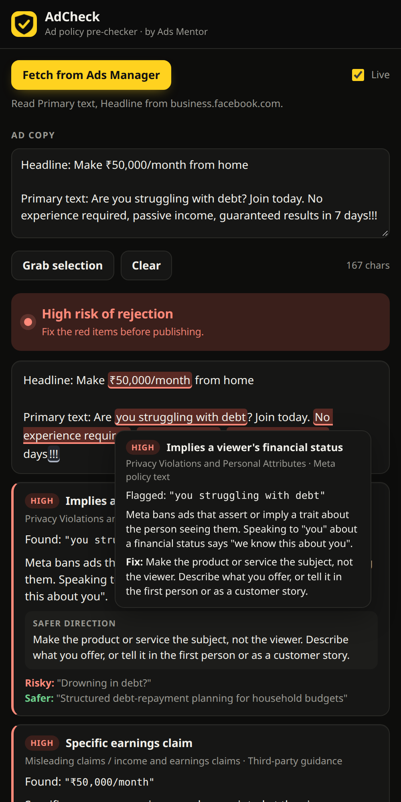

<p align="center"></p>

<h1 align="center">AdCheck by Ads Mentor</h1>
<p align="center"><b>Catch Meta ad rejections before you publish.</b><br>
A free Chrome side panel that reads your ad in Meta Ads Manager and flags wording and creatives likely to be rejected, with the reason and a safer fix.</p>

<p align="center">
  <a href="https://iam-knr.github.io/adsmentor-adcheck/">Website</a> ·
  <a href="https://iam-knr.github.io/adsmentor-adcheck/try/">Try it online</a> ·
  <a href="https://iam-knr.github.io/adsmentor-adcheck/#install">Install</a> ·
  <a href="https://adcheck.iamknr.in/privacy/">Privacy</a>
</p>

<p align="center"><br><sub>Demo ad copy. Hover any highlight to see why it was flagged.</sub></p>

## What it does
- **Reads your ad automatically.** Pulls Primary text, Headline and Description (and the creatives in the preview) from Meta Ads Manager when you open the panel. A Live mode re-checks as you edit.
- **Explains every flag on hover.** Severity, the policy behind it, why it's a problem, and how to fix it.
- **Suggests safer wording** with risky-versus-safer examples.
- **India-aware.** Flags placement guarantees, salary figures, pay-after-placement fees and government-approval claims that ASCI and CCPA scrutinise.
- **Checks creatives.** Quick local checks (layout, resolution, aspect ratio) plus an optional **Deep check** that has an AI model read the text in an image. Bring your own key: a free [OpenRouter](https://openrouter.ai) key works, or use the Anthropic API.
- **Private by default.** Copy is checked inside the panel. Nothing is sent anywhere unless you click Deep check on a creative.

## Roadmap
| Platform | Status |
|---|---|
| Meta Ads (Facebook, Instagram) | Available |
| Google Ads | Coming soon |
| LinkedIn Ads | Coming soon |

## Install (unpacked)
1. Download `adcheck-extension-v0.5.0.zip` from [`docs/download`](docs/download) and unzip it. (Or clone this repo and use the `extension/` folder.)
2. Open `chrome://extensions` and turn on **Developer mode**.
3. Click **Load unpacked** and choose the folder.
4. Open an ad in Meta Ads Manager and click the AdCheck icon (or press `Alt+Shift+A`).

## Honest limits
AdCheck is a second opinion, not a verdict. The rules come from Meta's published Advertising Standards, third-party guidance and summaries of ASCI/CCPA rules, and have **not** been validated against a large set of real rejected ads (see [`research/policy-dataset.md`](research/policy-dataset.md) for sources and gaps). A clean result is **not** a guarantee of approval: Meta also reviews images, landing pages and account history. Local creative checks are rough signals. Some AI models are rate-limited and the provider may log prompts, so don't send confidential client creatives to them.

AdCheck is an independent tool and is not affiliated with or endorsed by Meta Platforms, Inc.

## Repo layout
```
extension/   the Chrome extension (Manifest V3, no build step)
docs/        the website (GitHub Pages) and the "try it online" demo
research/    policy sources, examples and known gaps
tools/       icon generator, engine sync and packaging scripts
```
Rules live in `extension/engine.js`. After editing it, run `tools/sync-engine.sh` to update the web demo, and `tools/package.sh` to rebuild the download zip.

## Contributing
Real rejected ads (with Meta's stated reason) are the most useful contribution, because they're what the rules are missing. Open an issue with the copy, the reason shown in Ads Manager, and whether the ad was later approved. Please remove client names and any personal data first.

## Credits
Built by **Kailas (KNR) Nath R** ([iamknr.in](https://iamknr.in)) and team **Ads Mentor** ([adsmentor.in](https://adsmentor.in)).

Released under the [MIT licence](LICENSE).
